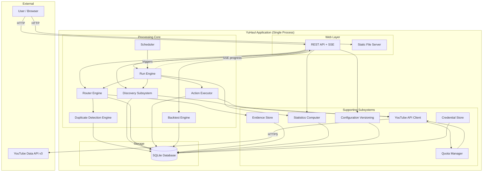

**Status:** superseded by [yuhaul-system-architecture-v2.md](../yuhaul-system-architecture-v2.md)

> This document has been superseded. The v2 architecture incorporates YouTube API compliance analysis (two-store data model) that was not addressed in this version.

## Satisfies

All 31 behavioral requirements across 13 domains (see [requirement index](../requirements/yuhaul/index.md)).

- [Account Connection](../requirements/yuhaul/account-connection.md)
- [Account Connection Security](../requirements/yuhaul/account-connection-security.md)
- [Subscription Discovery](../requirements/yuhaul/subscription-discovery.md)
- [Route Definition](../requirements/yuhaul/route-definition.md)
- [Route Conditions and Actions](../requirements/yuhaul/route-conditions-actions.md)
- [Multi-Route Matching](../requirements/yuhaul/multi-route-matching.md)
- [Final Route](../requirements/yuhaul/final-route.md)
- [Exclusion Behaviors](../requirements/yuhaul/exclusion-behaviors.md)
- [Duplicate Detection](../requirements/yuhaul/duplicate-detection.md)
- [Historical Title Persistence](../requirements/yuhaul/historical-title-persistence.md)
- [Duplicate Provenance](../requirements/yuhaul/duplicate-provenance.md)
- [Processing State Persistence](../requirements/yuhaul/processing-state-persistence.md)
- [Idempotent Execution](../requirements/yuhaul/idempotent-execution.md)
- [Quota Deferral](../requirements/yuhaul/quota-deferral.md)
- [Quota Accounting](../requirements/yuhaul/quota-accounting.md)
- [Quota-Aware Processing](../requirements/yuhaul/quota-aware-processing.md)
- [Decision Evidence](../requirements/yuhaul/decision-evidence.md)
- [Scheduled Runs](../requirements/yuhaul/scheduled-runs.md)
- [Manual Runs](../requirements/yuhaul/manual-runs.md)
- [Error Queue](../requirements/yuhaul/error-queue.md)
- [Failure Retention](../requirements/yuhaul/failure-retention.md)
- [Run-Level and Route-Level Statistics](../requirements/yuhaul/run-route-statistics.md)
- [Source/Channel Statistics](../requirements/yuhaul/source-channel-statistics.md)
- [Retention/Value Signals](../requirements/yuhaul/retention-signals.md)
- [Temporal Statistics](../requirements/yuhaul/temporal-statistics.md)
- [Trend Visualization](../requirements/yuhaul/trend-visualization.md)
- [Configuration History](../requirements/yuhaul/configuration-history.md)
- [Dry-Run Evaluation](../requirements/yuhaul/dry-run.md)
- [Historical Backtesting](../requirements/yuhaul/backtesting.md)
- [Run Inspection](../requirements/yuhaul/run-inspection.md)
- [Responsive Administration](../requirements/yuhaul/responsive-administration.md)
- [User Authority](../requirements/yuhaul/user-authority.md)
- [Outcome Distinction](../requirements/yuhaul/outcome-distinction.md)

## Traceability

| Requirement | Status | Notes |
|---|---|---|
| Account Connection | Satisfied | §OAuth and Credential Storage covers OAuth2 flow, token persistence |
| Account Connection Security | Satisfied | §Security Threat Model covers token encryption, access scoping |
| Subscription Discovery | Satisfied | §Discovery Subsystem covers polling-based channel feed retrieval |
| Route Definition | Satisfied | §Data Model — Route entity, §Processing Pipeline — Router |
| Route Conditions and Actions | Satisfied | §Data Model — Condition/Action entities, §Router Engine |
| Multi-Route Matching | Satisfied | §Router Engine — evaluation semantics |
| Final Route | Satisfied | §Router Engine — final-route termination logic |
| Exclusion Behaviors | Satisfied | §Router Engine — pre-evaluation exclusion gate |
| Duplicate Detection | Satisfied | §Duplicate Detection Engine — exact + fuzzy matching |
| Historical Title Persistence | Satisfied | §Data Model — TitleCorpus entity, §Migration |
| Duplicate Provenance | Satisfied | §Data Model — DuplicateMatch entity with provenance fields |
| Processing State Persistence | Satisfied | §State Management — durable video outcome records |
| Idempotent Execution | Satisfied | §State Management — action completion tracking, idempotency guards |
| Quota Deferral | Satisfied | §Quota Management — deferral semantics, deferred queue |
| Quota Accounting | Satisfied | §Quota Management — QuotaLedger entity, per-call tracking |
| Quota-Aware Processing | Satisfied | §Quota Management — pre-flight budget check, priority-aware allocation |
| Decision Evidence | Satisfied | §Decision Evidence — DecisionEvidence entity, per-route condition audit |
| Scheduled Runs | Satisfied | §Scheduling and Recovery — internal scheduler |
| Manual Runs | Satisfied | §API Surface — manual run trigger endpoint |
| Error Queue | Satisfied | §State Management — FailedItem entity with retry/remove |
| Failure Retention | Satisfied | §State Management — error categorization, no-silent-drop invariant |
| Run/Route Statistics | Satisfied | §Statistics and Analytics — RunStats, RouteStats entities |
| Source/Channel Statistics | Satisfied | §Statistics and Analytics — ChannelStats entity, per-channel aggregation |
| Retention/Value Signals | Satisfied | §Statistics and Analytics — optional retention fields, graceful degradation |
| Temporal Statistics | Satisfied | §Statistics and Analytics — time-bucketed aggregation, per-run granularity |
| Trend Visualization | Satisfied | §Web Interface — chart endpoints, time-series data API |
| Configuration History | Satisfied | §Configuration Versioning — ConfigVersion snapshots, run-linked versions |
| Dry-Run Evaluation | Satisfied | §Processing Pipeline — dry-run mode flag, action suppression |
| Historical Backtesting | Satisfied | §Backtesting Engine — offline evaluation against retained observations |
| Run Inspection | Satisfied | §API Surface — run detail endpoints, §Decision Evidence |
| Responsive Administration | Satisfied | §Web Interface — SPA with responsive layout per designer spec |
| User Authority | Satisfied | §Processing Pipeline — advisory-only, no autonomous policy changes |
| Outcome Distinction | Satisfied | §Data Model — five-state VideoOutcome enum, null-is-not-rejected invariant |

## Problem

YuHaul is a personal tool that discovers videos from a user's YouTube subscriptions, evaluates them against configurable routing rules, adds qualifying videos to playlists, and measures channel/route effectiveness. It is a rebuild of an existing application that has accumulated a historical corpus of video titles and decision evidence. The new system must preserve this corpus, support high-volume fuzzy duplicate detection (primary use case: music discovery where the same song appears across many channels under slightly varying titles), manage YouTube's strict API quota (10,000 units/day), provide full decision explainability, and deliver temporal analytics — all within a single-user, self-hosted deployment.

The core architectural tension is that YouTube's quota model makes the external API a scarce, metered resource that must be treated as a first-class constraint on processing, not an afterthought. Every subsystem that touches the YouTube API must be aware of remaining budget and able to defer work without data loss.

## Constraints

- **Single-user personal tool.** No multi-tenancy, no shared state, no concurrent users. The system serves exactly one YouTube account.
- **YouTube Data API v3 quota.** Default 10,000 units/day. Varying costs per method (e.g., `search.list` = 100 units, `videos.list` = 1 unit, `playlistItems.insert` = 50 units). Quota resets at midnight Pacific time.
- **Historical data migration.** Existing application has a corpus of video titles and decision evidence that must be importable.
- **Polling, not streaming.** Discovery operates on a scheduled/on-demand basis, not continuous monitoring.
- **No autonomous policy changes.** System advises; user decides. No auto-unsubscribe, no rule optimization, no ML classification.
- **Responsive web interface.** Desktop and mobile. SPA with URL state per designer spec.
- **Deployment.** Single-user self-hosted, likely Docker container. Minimal infrastructure dependencies.

## Invariants & Guarantees

### INV-1: No Silent Data Loss

**Guarantee:** No eligible video is silently dropped from processing. Every discovered video reaches one of five terminal states: accepted, rejected, deferred, failed, or not-yet-evaluated.

**Precondition:** The discovery subsystem persists discovered video identifiers before any downstream processing begins.

**Component:** Discovery subsystem → Video entity (discovered_at, outcome=not-yet-evaluated).

**Falsification test:** After a run completes, count(discovered videos) = count(accepted) + count(rejected) + count(deferred) + count(failed) + count(not-yet-evaluated). Any gap is a violation.

### INV-2: Quota Exhaustion Is Operational State, Not Error

**Guarantee:** Quota exhaustion never produces a false rejection. Videos not processed due to quota are deferred, preserving their eligibility for the next run.

**Precondition:** The quota ledger accurately tracks remaining budget before each API call.

**Component:** QuotaLedger entity → pre-flight budget check in Processing Pipeline.

**Falsification test:** Exhaust quota mid-run; verify deferred videos appear in next run's processing queue, not in the rejected set.

### INV-3: Idempotent Playlist Actions

**Guarantee:** Re-executing a run or reprocessing a video does not duplicate playlist insertions.

**Precondition:** Action completion is recorded with (video_id, playlist_id) identity.

**Component:** ExecutedAction entity with unique constraint on (run_id, video_id, playlist_id, action_type).

**Falsification test:** Execute a run, then re-execute the same run. Verify playlist item count is unchanged.

### INV-4: Decision Evidence Completeness

**Guarantee:** Every routing outcome is explainable from stored evidence without external log analysis.

**Precondition:** The router records condition evaluation results for every route evaluated against every video.

**Component:** DecisionEvidence entity → per-route condition audit trail.

**Falsification test:** For any video outcome in any historical run, the user can trace the exact route evaluation sequence and condition results that produced the outcome.

### INV-5: Configuration-Statistics Attribution

**Guarantee:** Every run's statistics are interpretable in the context of the configuration version that was active during that run.

**Precondition:** A configuration snapshot is created whenever routes change, and each run records its active config version.

**Component:** ConfigVersion entity → Run.config_version_id foreign key.

**Falsification test:** Modify routes, run, then inspect the historical run — the route conditions shown must match the configuration at the time of the run, not the current configuration.

### INV-6: Historical Corpus Integrity

**Guarantee:** Imported historical titles produce identical duplicate detection results as natively captured titles. The corpus is a first-class data citizen, not a second-class import.

**Precondition:** The title corpus schema is identical for imported and native titles.

**Component:** TitleCorpus entity — no schema distinction between import sources.

**Falsification test:** Import historical titles, run duplicate detection against a known duplicate — result must match what the prior system would have produced.

### INV-7: Distinct Outcome States (AC 32)

**Guarantee:** The system distinguishes five outcome states and never represents absence of processing as a negative routing decision.

**Precondition:** Video outcome is set to not-yet-evaluated at discovery time and only transitions through explicit processing.

**Component:** VideoOutcome enum: {accepted, rejected, deferred, failed, not_yet_evaluated}.

**Falsification test:** A video that was never evaluated (discovered but quota exhausted before processing) shows as not-yet-evaluated, not rejected.

### INV-8: Dry-Run and Backtest Isolation

**Guarantee:** Dry-run and backtest modes produce routing evaluations without mutating external state (YouTube playlists, subscriptions).

**Precondition:** Action execution is gated by a mode flag that suppresses external API calls.

**Component:** RunMode enum: {live, dry_run, backtest} → action executor checks mode before external calls.

**Falsification test:** Execute a dry-run; verify zero playlist mutation API calls were made (QuotaLedger shows no playlistItems.insert/DELETE calls).

## Options Considered

### Storage Technology

#### Option A: SQLite with FTS5

**How it works:** Single embedded database file with SQLite's full-text search extension for title corpus search. All data in one file with WAL mode for concurrent reads during processing.

**Pros:** Zero operational overhead (no database server), single-file backup, natural fit for single-user, FTS5 provides trigram and BM25 ranking for fuzzy title matching, supports complex queries via SQL, migration is a file copy, well-understood tooling.

**Cons:** FTS5 provides token-based similarity, not edit-distance natively — fuzzy duplicate detection at ~97% Levenshtein threshold requires either application-level edit-distance computation on FTS5 candidates or a custom approach. Single-writer constraint under WAL mode (acceptable for single-user). No built-in time-series optimization.

**Risks:** FTS5 may not be sufficient as the sole fuzzy matching mechanism — may need application-level similarity computation as a second pass. Title corpus at thousands-of-entries scale is well within SQLite's capability.

#### Option B: PostgreSQL

**How it works:** Full relational database server with pg_trgm extension for trigram similarity (native edit-distance-like matching), TimescaleDB for time-series analytics.

**Pros:** pg_trgm provides native fuzzy string matching with configurable similarity thresholds, excellent for analytics queries, mature ecosystem.

**Cons:** Requires a database server process, adds deployment complexity (Docker compose with two containers), over-engineered for single-user, operational burden of database maintenance, backup is pg_dump not file copy.

**Risks:** Infrastructure complexity disproportionate to single-user scope. User must manage database lifecycle.

#### Option C: Hybrid — SQLite for core data + application-level fuzzy matching

**How it works:** SQLite stores all entities. Fuzzy duplicate detection uses a two-pass approach: (1) FTS5 retrieves candidate titles using token overlap, (2) application computes normalized edit distance (or other similarity metric) on candidates against a configurable threshold. The similarity algorithm is abstracted behind an interface so the specific algorithm can be changed without schema changes.

**Pros:** Combines SQLite's simplicity with flexible similarity matching. The two-pass approach narrows the candidate set via FTS5 before expensive pairwise comparison. Algorithm is pluggable. Single-file database preserved.

**Cons:** Requires custom application code for similarity computation. The FTS5 candidate retrieval may miss titles with very different tokenization but high edit-distance similarity (e.g., "Remix 2024" vs "Remix (2024 Official)"). This is mitigable with broad candidate retrieval.

**Risks:** Candidate set size must be tuned — too narrow misses duplicates, too wide is slow. At corpus sizes of thousands (not millions), this is tractable.

**Recommendation:** Option C — SQLite with FTS5 candidate retrieval + application-level similarity. This preserves single-file deployment, provides the fuzzy matching flexibility the anchor requires ("equivalent capability without binding to that exact algorithm"), and scales well for the expected corpus size.

### Processing Model

#### Option A: Pure Batch

**How it works:** Each run processes all discovered videos in a single batch. Discovery → filter → route evaluation → action execution happen sequentially within one run invocation.

**Pros:** Simple model, easy to reason about, natural fit for scheduled polling.

**Cons:** Long runs may hit quota mid-batch with no graceful deferral. No ability to process high-priority videos first. A failure mid-batch requires careful state recovery.

#### Option B: Queue-Based

**How it works:** Discovery enqueues video processing work items. Workers dequeue and process individually. Deferred and failed items re-enter the queue.

**Pros:** Natural deferral semantics, priority ordering, individual failure isolation.

**Cons:** Over-engineered for single-user — a message queue adds complexity disproportionate to the problem. Queue state must be persisted, adding another storage concern.

#### Option C: Batch with Internal Priority Queue

**How it works:** Each run operates as a batch but maintains an internal priority-ordered work list. Videos are processed in priority order (new discoveries first, deferred from prior runs second, retried errors third). The work list is persisted to the database, so interruption recovery resumes from the last processed item. Quota budget is checked before each item. Deferred items remain in the work list for the next run.

**Pros:** Simple batch semantics with graceful quota handling and failure recovery. No external queue dependency. Priority ordering ensures high-value work completes first under quota pressure. Persistence means restarts resume naturally.

**Cons:** Not truly concurrent — single-threaded processing. Acceptable for single-user with no real-time requirements.

**Recommendation:** Option C. The internal priority queue gives us the resilience of a queue without the operational complexity. The persisted work list satisfies state persistence across restarts (INV-1, processing-state-persistence).

### Duplicate Detection Algorithm

#### Option A: Pure Levenshtein

**How it works:** Compute normalized Levenshtein edit distance between every candidate title pair. Threshold at ~97%.

**Pros:** Well-understood, matches prior system behavior exactly.

**Cons:** O(n²) comparison against full corpus. Slow at scale. Does not handle token reordering ("Song Name - Artist" vs "Artist - Song Name").

#### Option B: FTS5 Candidate Retrieval + Configurable Similarity

**How it works:** Phase 1: FTS5 full-text search retrieves titles with token overlap (broad retrieval — top N candidates per query title). Phase 2: Application-level similarity computation on candidates. The similarity function is abstracted behind an interface with a default implementation combining: (a) normalized edit distance for character-level similarity, (b) token-set Jaccard similarity for reordering tolerance. The user-configurable threshold applies to the combined score. Exact match is by YouTube video ID.

**Pros:** Scales well — FTS5 narrows candidates from thousands to dozens. Configurable similarity function supports both music (high reordering tolerance) and non-music use cases. Abstracted interface allows algorithm evolution without schema changes. The anchor requires "equivalent capability without binding to that exact algorithm."

**Cons:** Two-pass approach may miss edge cases where token overlap is zero but edit distance is high. Mitigable with broad FTS5 retrieval parameters.

#### Option C: N-gram Index

**How it works:** Build an in-memory n-gram index over the title corpus. Query with the new title's n-grams, retrieve candidates with high n-gram overlap, then compute precise similarity.

**Pros:** Good at finding similar strings even with different tokenization.

**Cons:** Memory-intensive for large corpora. Requires index maintenance. More complex than FTS5 which provides similar capability natively.

**Recommendation:** Option B. The two-pass approach provides the flexibility the anchor requires, scales well for the expected corpus, and leverages SQLite's built-in FTS5 rather than adding a custom index.

### Statistics Computation Strategy

#### Option A: Real-Time Computation

**How it works:** Statistics are computed on-the-fly from raw outcome data whenever the user views analytics.

**Pros:** Always accurate, no staleness.

**Cons:** Slow for large datasets with temporal aggregation. Analytics queries scan all historical runs.

#### Option B: Pre-Computed Aggregation Tables

**How it works:** At the end of each run, update pre-computed aggregate tables (daily/weekly/monthly buckets for run stats, route stats, channel stats).

**Pros:** Fast reads for analytics views. Natural temporal grouping.

**Cons:** Aggregation logic must be maintained in sync with raw data. Backfill needed for historical data migration.

#### Option C: Hybrid — Raw Data with Materialized Views

**How it works:** Raw outcome data is the source of truth. At the end of each run, update materialized summary tables for common aggregations (per-run, per-route-per-run, per-channel-per-run). Temporal queries combine materialized summaries for completed periods with live aggregation for the current period. SQLite views or application-managed summary tables.

**Pros:** Raw data preserved for drill-down. Materialized summaries for fast dashboard rendering. Simple to implement in SQLite. Backtest and dry-run results can share the same summary schema.

**Cons:** Summary tables add write overhead at end of run. Must handle partial-run summaries correctly.

**Recommendation:** Option C. The hybrid approach gives fast dashboard reads while preserving full granularity for run inspection and backtesting. For a single-user system, the write overhead is negligible.

### API Surface Design

#### Option A: REST API with JSON

**How it works:** Backend exposes RESTful HTTP endpoints. Frontend SPA communicates via JSON over HTTP.

**Pros:** Simple, well-understood, good tooling, natural fit for CRUD operations on routes/runs/channels.

**Cons:** Polling required for run progress updates. Multiple round-trips for related data.

#### Option B: GraphQL

**How it works:** Backend exposes a single GraphQL endpoint. Frontend queries exactly the data it needs.

**Pros:** Flexible queries, reduced over-fetching, single round-trip for complex views.

**Cons:** More complex backend implementation, overkill for single-user with known view requirements, additional schema maintenance.

#### Option C: REST API with Server-Sent Events (SSE) for progress

**How it works:** RESTful endpoints for all CRUD and query operations. SSE endpoint for run progress updates — the backend pushes progress events to the browser during a run.

**Pros:** REST simplicity for most operations plus real-time progress without polling. SSE is simpler than WebSocket, works with standard HTTP infrastructure, natural fit for one-way progress updates.

**Cons:** Slightly more complex than pure REST. SSE connection management.

**Recommendation:** Option C. REST covers all CRUD and query needs. SSE provides real-time run progress feedback (the designer's spec calls for progress indicators during runs) without the complexity of WebSocket or the latency of polling.

## Recommendation

The recommended architecture is a **monolithic single-process application** with:

- **SQLite + FTS5** for all persistent storage (core data + title corpus search)
- **Application-level similarity computation** for fuzzy duplicate detection (two-pass: FTS5 candidates → configurable similarity function)
- **Batch processing with internal persisted priority queue** for run execution
- **Hybrid statistics** (raw data + materialized summaries updated per-run)
- **REST API + SSE** for the web interface
- **Single-process deployment** in Docker (or bare binary)

This is a deliberately simple architecture for a deliberately scoped system. The single-user constraint eliminates distributed-system concerns. The polling-based discovery model eliminates streaming infrastructure. The quota-as-first-class-constraint model shapes every subsystem that touches the YouTube API.

## System Architecture

### Component Diagram



### Component Responsibilities

| Component | Responsibility | Key Interfaces |
|---|---|---|
| **REST API + SSE** | HTTP endpoints for all UI operations; SSE stream for run progress | `GET/POST/PUT/DELETE /api/routes`, `/api/runs`, `/api/analytics`, `/api/errors`, `/api/settings`; `GET /api/runs/:id/progress` (SSE) |
| **Static File Server** | Serves the SPA bundle (HTML, JS, CSS, assets) | `GET /*` (fallback to index.html for SPA routing) |
| **Scheduler** | Triggers runs on a user-configured schedule; no continuous monitoring | Cron-like expression evaluator, internal timer |
| **Run Engine** | Orchestrates a processing run: discovery → evaluation → action → statistics | `start_run(mode)`, `resume_run(run_id)`, run lifecycle state machine |
| **Discovery Subsystem** | Fetches subscribed channels and their recent videos from YouTube API | `discover_videos(since_timestamp)` → list of candidate videos |
| **Router Engine** | Evaluates videos against ordered routes, applies exclusion rules, records evidence | `evaluate_video(video, routes, config)` → VideoOutcome + DecisionEvidence |
| **Duplicate Detection Engine** | Exact (by ID) and fuzzy (by title similarity) duplicate detection against corpus | `check_duplicate(video)` → DuplicateResult (none, exact, fuzzy with score + provenance) |
| **Action Executor** | Executes playlist additions and other route actions; respects dry-run/backtest mode | `execute_action(action, video, mode)` → ActionResult |
| **Backtest Engine** | Evaluates proposed route configurations against historical observations offline | `run_backtest(proposed_config, date_range)` → BacktestResult |
| **Quota Manager** | Tracks YouTube API quota consumption, enforces budget, provides pre-flight checks | `check_budget(estimated_cost)`, `record_usage(method, cost)`, `remaining()` |
| **Evidence Store** | Records and queries decision evidence for every routing outcome | `record_evidence(video, route_evaluations)`, `query_evidence(run_id, video_id)` |
| **Statistics Computer** | Computes run/route/channel statistics; updates materialized summaries | `compute_run_stats(run_id)`, `query_temporal_stats(date_range, group_by)` |
| **Configuration Versioning** | Snapshots route configuration on change; links runs to active config version | `snapshot_config()` → ConfigVersion, `config_at(run_id)` → frozen config |
| **YouTube API Client** | Thin wrapper around YouTube Data API v3 with quota-aware call gating | `list_subscriptions()`, `list_videos(ids)`, `insert_playlist_item()`, etc. |
| **Credential Store** | Stores and retrieves OAuth tokens; handles token refresh | `get_credentials()`, `refresh_token()`, `store_credentials()` |

## Data Model

### Entity-Relationship Diagram

```mermaid
erDiagram
    Account ||--o{ Subscription : "has"
    Subscription ||--o{ Video : "publishes via"
    Channel ||--o{ Subscription : "subscribed to"
    Channel ||--o{ Video : "publishes"
    
    Video ||--o| VideoOutcome : "has"
    Video ||--o{ DecisionEvidence : "evaluated in"
    Video }o--o| TitleCorpus : "title stored in"
    Video ||--o{ DuplicateMatch : "matched as"
    Video ||--o{ ExecutedAction : "actions taken"
    Video ||--o{ ErrorEntry : "failure recorded"
    
    Route ||--o{ Condition : "has"
    Route ||--o{ RouteAction : "has"
    Route ||--o{ DecisionEvidence : "evaluated against"
    Route ||--o{ RouteRunStats : "stats per run"
    
    Run ||--o{ VideoOutcome : "produces"
    Run ||--o{ DecisionEvidence : "contains"
    Run ||--o{ RouteRunStats : "aggregates"
    Run ||--o{ QuotaLedgerEntry : "consumes"
    Run }o--|| ConfigVersion : "uses"
    
    ConfigVersion ||--o{ Run : "active during"
    
    TitleCorpus ||--o{ DuplicateMatch : "matched against"

    Account {
        string id PK
        string youtube_account_id
        string display_name
        datetime connected_at
        datetime token_expires_at
    }
    
    Channel {
        string id PK
        string youtube_channel_id UK
        string title
        string description
        datetime first_seen_at
    }
    
    Subscription {
        string id PK
        string account_id FK
        string channel_id FK
        datetime subscribed_at
        boolean is_excluded
    }
    
    Video {
        string id PK
        string youtube_video_id UK
        string channel_id FK
        string title
        string description
        integer duration_seconds
        datetime published_at
        datetime discovered_at
    }
    
    VideoOutcome {
        string id PK
        string video_id FK
        string run_id FK
        enum outcome "accepted|rejected|deferred|failed|not_yet_evaluated"
        string deferred_reason "nullable"
        string failure_category "nullable: api_error|quota|auth|runtime"
        string failure_message "nullable"
        datetime decided_at
    }
    
    Route {
        string id PK
        string name
        string description
        integer evaluation_order
        boolean is_enabled
        boolean is_final
        datetime created_at
        datetime updated_at
    }
    
    Condition {
        string id PK
        string route_id FK
        enum field "title|channel|duration|published_at|..."
        enum operator "contains|equals|gt|lt|regex|..."
        string value
        enum logical_connective "AND|OR"
        integer position
    }
    
    RouteAction {
        string id PK
        string route_id FK
        enum action_type "add_to_playlist|tag|..."
        string target_playlist_id "nullable"
        json parameters "nullable"
        integer position
    }
    
    DecisionEvidence {
        string id PK
        string video_id FK
        string run_id FK
        string route_id FK
        integer evaluation_order
        boolean conditions_matched
        json condition_details "per-condition match results"
        boolean actions_would_execute
        boolean actions_executed
        datetime evaluated_at
    }
    
    TitleCorpus {
        string id PK
        string title
        string normalized_title "lowercased, stripped"
        string video_id FK "nullable — imported titles may lack video_id"
        string source "native|imported"
        datetime captured_at
    }
    
    DuplicateMatch {
        string id PK
        string video_id FK "the newly discovered video"
        string corpus_entry_id FK "the matching corpus entry"
        enum match_type "exact_id|exact_title|fuzzy"
        float similarity_score "nullable for exact matches"
        string matched_route_id FK "nullable — which route flagged the duplicate"
        string original_source_channel_id FK "nullable — who first discovered"
        datetime matched_at
    }
    
    ExecutedAction {
        string id PK
        string video_id FK
        string run_id FK
        string route_id FK
        enum action_type
        string target_id "playlist_id etc."
        enum status "completed|failed|skipped_dry_run"
        string youtube_operation_id "nullable"
        datetime executed_at
    }
    
    ErrorEntry {
        string id PK
        string video_id FK
        string run_id FK "nullable — may be from retry"
        enum error_category "api_error|quota|auth|runtime"
        string error_message
        json context "error details, stack trace, etc."
        integer retry_count
        datetime failed_at
        datetime resolved_at "nullable"
    }
    
    Run {
        string id PK
        enum mode "live|dry_run|backtest"
        enum trigger_type "scheduled|manual|backtest"
        string config_version_id FK
        datetime started_at
        datetime completed_at "nullable"
        enum status "running|completed|interrupted|failed"
        integer videos_discovered
        integer videos_accepted
        integer videos_rejected
        integer videos_deferred
        integer videos_failed
    }
    
    RouteRunStats {
        string id PK
        string run_id FK
        string route_id FK
        integer videos_evaluated
        integer videos_matched
        integer actions_executed
        integer actions_failed
    }
    
    ChannelStats {
        string id PK
        string channel_id FK
        string run_id FK
        integer videos_discovered
        integer videos_accepted
        integer videos_rejected
        integer videos_deferred
        integer videos_failed
    }
    
    QuotaLedgerEntry {
        string id PK
        string run_id FK
        string api_method "e.g., search.list, videos.list"
        integer units_consumed
        datetime recorded_at
    }
    
    ConfigVersion {
        string id PK
        json route_snapshot "full serialized route configuration"
        json exclusion_snapshot "exclusion rules"
        json settings_snapshot "quota limits, schedule, etc."
        string change_description "nullable"
        datetime created_at
    }
    
    ExclusionRule {
        string id PK
        enum rule_type "channel|video|title_phrase|ignored_word|duration_min|duration_max"
        string value
        boolean is_enabled
        datetime created_at
    }
    
    Settings {
        string key PK
        string value
        datetime updated_at
    }
```



### Key Design Decisions in the Data Model

**Video outcome as separate entity.** VideoOutcome is separate from Video because a video can be re-evaluated across multiple runs (e.g., deferred in run 1, accepted in run 2). The Video entity represents the discovered video; VideoOutcome represents its processing result in a specific run. The "current" outcome for a video is the outcome from its most recent run.

**TitleCorpus separate from Video.** The title corpus must persist independently of video metadata and must support imported titles that may lack full video metadata. TitleCorpus stores the normalized title for duplicate detection and optionally links to a Video entity. Imported titles have `source='imported'` and may have null `video_id`.

**DecisionEvidence per route per video.** Each route evaluation against a video produces one DecisionEvidence record. This provides the full audit trail the UI's Decision Detail view requires (the vertical evaluation sequence from the designer's spec, DD-5).

**ConfigVersion as JSON snapshot.** Route configurations are serialized as JSON in ConfigVersion. This is intentional — the configuration must be frozen at a point in time and must not change when routes are subsequently modified. JSON is the natural serialization format for the route model, and querying inside the snapshot is not needed (runs reference the version by ID, and the UI retrieves the full snapshot for display).

**ChannelStats as per-run materialization.** Channel statistics are computed per run and stored as materialized rows. This enables efficient temporal queries (channel performance over time) without scanning all video outcomes.

## Processing Pipeline

### Run Lifecycle

```
┌──────────┐    ┌───────────┐    ┌──────────┐    ┌──────────┐    ┌──────────┐    ┌──────────┐
│  Trigger  │───▶│ Discovery │───▶│ Exclusion│───▶│ Duplicate│───▶│  Route   │───▶│  Action  │
│ (schedule │    │ (fetch    │    │  Gate    │    │ Detection│    │Evaluation│    │Execution │
│  or manual)│    │  channels │    │ (filter  │    │ (exact + │    │ (ordered │    │ (playlist│
│           │    │  & videos)│    │  excluded)│    │  fuzzy)  │    │  routes) │    │  insert) │
└──────────┘    └───────────┘    └──────────┘    └──────────┘    └──────────┘    └──────────┘
                      │                │                │               │               │
                      ▼                ▼                ▼               ▼               ▼
                 ┌─────────────────────────────────────────────────────────────────────────┐
                 │                    Quota Manager (pre-flight check before each API call) │
                 └─────────────────────────────────────────────────────────────────────────┘
                      │
                      ▼
                 ┌──────────┐    ┌──────────┐
                 │Statistics│    │ Evidence  │
                 │Computation│    │ Recording │
                 └──────────┘    └──────────┘
```

### Detailed Pipeline Steps

**1. Trigger.** Scheduler fires on configured schedule, or user initiates manual/dry-run via API. Run Engine creates a Run record with mode (live/dry_run/backtest), trigger_type, and config_version_id (current active config snapshot).

**2. Discovery.** Discovery Subsystem fetches the user's subscription list (YouTube `subscriptions.list`), then for each subscribed (non-excluded) channel, fetches recent uploads (YouTube `search.list` or `playlistItems.list` for the channel's uploads playlist, followed by `videos.list` for metadata). New videos (not already in Video table) are inserted with `outcome = not_yet_evaluated`. The Quota Manager tracks all API calls and their costs.

**3. Build Work List.** The Run Engine constructs a priority-ordered work list:
   - Priority 1: Videos with outcome = not_yet_evaluated (new discoveries)
   - Priority 2: Videos with outcome = deferred from prior runs
   - Priority 3: Videos from ErrorEntry with retry requested by user
   
   The work list is persisted to the database so interrupted runs can resume.

**4. Exclusion Gate.** For each video in the work list, check against ExclusionRules:
   - Channel exclusion (channel_id in excluded channels)
   - Video exclusion (video_id in excluded videos)
   - Title phrase exclusion (title contains excluded phrase)
   - Ignored word exclusion (title contains ignored word)
   - Duration limits (duration outside min/max bounds)
   
   Excluded videos are recorded with outcome = rejected and evidence noting the exclusion rule. No API calls are made for excluded videos.

**5. Duplicate Detection.** For non-excluded videos:
   - **Exact match:** Check if video_id exists in TitleCorpus or Video table with an accepted outcome. If yes, record as exact duplicate with provenance.
   - **Fuzzy match:** Query FTS5 for candidate titles with token overlap. For each candidate, compute similarity score using the configured similarity function. If score exceeds threshold, record as fuzzy duplicate with score and provenance (which route originally discovered the original, which route flagged the duplicate).
   - Duplicates are recorded in DuplicateMatch with provenance data.
   - Duplicate handling behavior is configurable: by default, duplicates are rejected with evidence noting the match.

**6. Route Evaluation.** For non-excluded, non-duplicate videos:
   - Evaluate against enabled routes in evaluation_order.
   - For each route, evaluate all conditions. Record per-condition match/no-match in DecisionEvidence.
   - If conditions match: record match, execute actions (if live mode), record ExecutedAction.
   - If route is marked `is_final` and matched: stop evaluation for this video.
   - If route is not final: continue to next route (multi-route matching).
   - If no route matches: outcome = rejected, evidence shows all routes evaluated.
   - If any route matched: outcome = accepted.

**7. Action Execution.** For matched routes in live mode:
   - Check quota budget via Quota Manager before each API call.
   - If budget insufficient: defer remaining work (outcome = deferred, deferred_reason = "quota_exhausted"). Do not execute the action. Do not mark as failed or rejected.
   - If action succeeds: record ExecutedAction with status = completed.
   - If action fails: record ExecutedAction with status = failed, create ErrorEntry.
   - In dry-run mode: record ExecutedAction with status = skipped_dry_run. No API call made.
   - In backtest mode: same as dry-run.

**8. Statistics Computation.** After all videos processed:
   - Compute RunStats (totals for accepted/rejected/deferred/failed/not_yet_evaluated).
   - Compute RouteRunStats per route (evaluated/matched/executed counts).
   - Compute ChannelStats per channel (discovered/accepted/rejected/deferred/failed).
   - Update materialized summary tables.
   - Update Run record with completed_at and summary counts.

**9. Quota Reconciliation.** After run completes, persist final quota usage to QuotaLedgerEntry records. Update daily quota tracking.

### Dry-Run and Backtest Mode Differences

| Aspect | Live | Dry-Run | Backtest |
|---|---|---|---|
| Discovery | Fetches from YouTube API | Fetches from YouTube API | Uses retained historical data (no API calls) |
| Exclusion | Applied | Applied | Applied |
| Duplicate Detection | Full | Full | Full against historical corpus |
| Route Evaluation | Full | Full | Full against proposed config |
| Action Execution | Executes playlist mutations | Records "would execute" without API calls | Records "would execute" without API calls |
| Statistics | Recorded | Recorded (marked as dry-run) | Recorded (marked as backtest) |
| Config Version | Active config | Active config | Proposed config (not saved) |
| External State Mutated | Yes (playlists) | No | No |

## State Management

### Video Processing States

```
not_yet_evaluated ──▶ [exclusion gate] ──▶ rejected (excluded)
        │
        ▼
   [duplicate detection] ──▶ rejected (duplicate)
        │
        ▼
   [route evaluation] ──▶ accepted ──▶ [action execution] ──▶ completed
        │                    │               │
        │                    │               ▼
        │                    │           failed ──▶ ErrorEntry
        │                    │
        │                    ▼
        │               rejected (no match)
        │
        ▼
   [quota exhausted] ──▶ deferred
```

**Five terminal states:**
1. **accepted** — Route matched, actions executed (or would-be in dry-run/backtest)
2. **rejected** — Excluded, duplicate, or no route matched
3. **deferred** — Not processed due to quota exhaustion; eligible for next run
4. **failed** — Encountered a transient error (API, auth, runtime); in ErrorEntry for retry
5. **not_yet_evaluated** — Discovered but not yet processed (quota ran out before reaching this video)

**Key invariant:** `not_yet_evaluated` is set at discovery time. It only transitions through explicit processing. A video that was discovered but never processed remains `not_yet_evaluated` — it is never silently promoted to `rejected`.

### Work List Persistence

The work list for each run is a persisted set of (video_id, priority) pairs. When a run is interrupted (application restart, quota exhaustion), the work list survives. On next run, the engine checks for incomplete work from prior runs and includes it in the new work list at appropriate priority.

### Error State

Failed items are stored in ErrorEntry with:
- Error category: `api_error`, `quota`, `auth`, `runtime`
- Error message and context (JSON)
- Retry count
- Video identity for re-processing

The user can retry (re-enqueues the video) or remove (marks resolved_at, removes from queue).

### Idempotency Guard

Before executing a playlist action, the system checks ExecutedAction for a completed entry with the same (video_id, playlist_id, action_type). If found, the action is skipped. This prevents duplicate playlist entries even if a run is re-executed.

## Quota Management

### Quota Model

The YouTube Data API v3 uses a unit-based quota system:

| API Method | Unit Cost |
|---|---|
| `subscriptions.list` | 1 |
| `channels.list` | 1 |
| `search.list` | 100 |
| `videos.list` | 1 |
| `playlistItems.list` | 1 |
| `playlistItems.insert` | 50 |
| `playlistItems.delete` | 50 |

Default daily quota: 10,000 units. Resets at midnight Pacific time.

### Quota Ledger

Every YouTube API call is recorded in QuotaLedgerEntry with:
- Run ID (which run consumed the quota)
- API method (which endpoint was called)
- Units consumed
- Timestamp

### Budget Management

**Pre-flight check.** Before every API call, the Quota Manager checks:
1. Remaining daily budget (10,000 - sum of today's QuotaLedgerEntry costs)
2. Estimated cost of the pending call
3. Whether sufficient budget remains for higher-priority work

**Priority-aware allocation.** When budget is low:
- Discovery operations (subscriptions.list, search.list) are deferred first — they can wait until the next run
- Video metadata retrieval (videos.list) is preferred over search — lower cost, already-discovered videos
- Playlist actions (playlistItems.insert) are deferred last — they represent completed evaluation work

**Quota exhaustion response.** When budget is insufficient:
- Remaining work items are marked as `deferred` with reason `quota_exhausted`
- No further API calls are made in this run
- The run completes with status `completed` (not `failed`)
- Deferred items appear in the next run's work list at priority 2

### Quota Visibility

The API exposes:
- Current day's usage (units consumed / 10,000 budget)
- Per-run consumption breakdown
- Historical consumption by run and by API method
- Projected exhaustion based on recent run patterns

## Decision Evidence

### Evidence Structure

Each DecisionEvidence record captures:

```json
{
  "video_id": "abc123",
  "run_id": "run_2026-09-08_0600",
  "route_id": "route_music_discovery",
  "evaluation_order": 1,
  "conditions_matched": true,
  "condition_details": [
    {
      "field": "title",
      "operator": "contains",
      "value": "lofi",
      "matched": true,
      "actual_value": "Lofi Hip Hop - Chill Beats 2026"
    },
    {
      "field": "duration",
      "operator": "gt",
      "value": "300",
      "matched": true,
      "actual_value": "3847"
    }
  ],
  "actions_would_execute": true,
  "actions_executed": true,
  "evaluated_at": "2026-09-08T06:12:34Z"
}
```

### Evidence Querying

The API supports:
- Evidence for a specific video in a specific run (Decision Detail view)
- Evidence for all videos in a run (Run Detail view)
- Evidence for a specific video across all runs (video history)

### Evidence Retention

Evidence is retained indefinitely. For storage efficiency, condition_details are stored as JSON rather than normalized into separate tables. At expected volumes (hundreds of videos per run, dozens of runs per month), storage is not a concern for SQLite.

## Duplicate Detection Engine

### Two-Pass Architecture

**Pass 1: Exact Match**
- Check if the video's YouTube video_id already exists in TitleCorpus or Video table
- Check if the video's exact title already exists in TitleCorpus (normalized: lowercased, stripped of common noise words)
- Both checks are simple SQL lookups — fast at any corpus size

**Pass 2: Fuzzy Match**
1. **Candidate Retrieval (FTS5):** Query the TitleCorpus FTS5 index with the new video's title tokens. Retrieve top-N candidates ranked by BM25 relevance. N is configurable (default: 50).
2. **Similarity Computation:** For each candidate, compute similarity using the configured similarity function. The default function combines:
   - **Normalized edit distance** (Levenshtein): character-level similarity, handles typos and small variations
   - **Token-set Jaccard similarity**: handles token reordering ("Song - Artist" vs "Artist - Song")
   - Combined score = weighted average (configurable weights, default: 0.6 edit + 0.4 Jaccard)
3. **Threshold Comparison:** If combined score ≥ user-configured threshold (default: 0.97), record as fuzzy duplicate.

### Provenance Tracking

Each DuplicateMatch records:
- **match_type:** exact_id, exact_title, or fuzzy
- **similarity_score:** the computed score (null for exact matches)
- **matched_route_id:** which route's evaluation flagged the duplicate (null if caught pre-route)
- **original_source_channel_id:** which channel first published the original content

This satisfies the provenance requirement (AC 10) — the system can distinguish "this video was originally discovered via channel X and route Y" from "this video was flagged as a duplicate of something channel Z published."

### Corpus Import

The import process accepts a structured data file (JSON or CSV) containing:
- Title (required)
- Video ID (optional — imported titles may lack this)
- Source channel (optional)
- Original discovery date (optional)

Imported titles are inserted into TitleCorpus with `source='imported'`. They participate in duplicate detection identically to native titles (INV-6).

### Normalization

Titles are normalized before storage and comparison:
1. Lowercase
2. Strip common noise tokens: `[Official]`, `(Official Video)`, `[HD]`, `(Lyrics)`, `[Music Video]`, etc. (configurable list)
3. Normalize whitespace
4. Strip leading/trailing punctuation artifacts

The normalized form is stored alongside the original for display purposes.

## Statistics and Analytics

### Three Levels of Granularity

**Level 1: Per-Run Raw Data**
- Every VideoOutcome, DecisionEvidence, ExecutedAction, QuotaLedgerEntry is recorded with run_id
- Supports full drill-down from any analytics view to individual video decisions

**Level 2: Per-Run Materialized Summaries**
- RouteRunStats: per-route counts within a run (evaluated, matched, executed, failed)
- ChannelStats: per-channel counts within a run (discovered, accepted, rejected, deferred, failed)
- Run summary counts on the Run record itself

**Level 3: Temporal Aggregation**
- Daily/weekly/monthly rollups computed from Level 2 data
- Supports the Analytics Dashboard trend charts (acceptance rate over time, videos processed over time, route match rates over time)
- Computed lazily: the Statistics Computer aggregates Level 2 data into time buckets on query, caching results for repeated queries

### Retention Signals (AC 22)

YouTube's API provides limited retention/engagement data for a user's own account:
- `statistics.viewCount`, `statistics.likeCount` on `videos.list`
- The user's own watch history is not API-accessible

The system captures what is available:
- View count and like count at time of processing (stored on Video entity)
- These are optional fields — when unavailable, no false signals are produced (graceful degradation)

Retention signals are associated with the video and route that matched, supporting the channel usefulness analysis.

### Analytics API

| Endpoint | Purpose | Data Source |
|---|---|---|
| `GET /api/analytics/trends?range=30d` | Time-series trend data | Level 3 aggregation |
| `GET /api/analytics/routes?range=30d` | Route performance over time | RouteRunStats |
| `GET /api/analytics/channels` | Channel list with summary stats | ChannelStats aggregated |
| `GET /api/analytics/channels/:id` | Single channel deep-dive | ChannelStats + VideoOutcome |
| `GET /api/runs/:id/stats` | Single run summary | Run + RouteRunStats |
| `GET /api/runs/:id/videos` | Video outcomes for a run | VideoOutcome + DecisionEvidence |

## Configuration Versioning

### Snapshot Model

A ConfigVersion snapshot is created whenever:
1. A route is created, updated, or deleted
2. An exclusion rule is added, modified, or removed
3. System settings (quota limits, schedule) are changed

The snapshot contains a full JSON serialization of:
- All routes with their conditions, actions, order, enabled/final state
- All exclusion rules
- Relevant settings (quota limits, schedule expression)

### Run-Config Linkage

Every Run record references the ConfigVersion that was active when the run started. This is set at run initiation and never changes, even if the configuration is modified during or after the run.

### Historical Interpretation

When the user views a historical run's statistics or decision evidence, the UI can show:
- The route configuration as it existed during that run (from the ConfigVersion snapshot)
- Which routes were enabled/disabled at that time
- The exclusion rules in effect

This satisfies AC 25: "Route/configuration history sufficient to interpret historical statistics."

### Backtest Integration

Backtesting creates a temporary ConfigVersion from the proposed configuration. The backtest run references this temporary version. If the user applies the proposed configuration, it becomes a real ConfigVersion. If discarded, the temporary version is deleted.

## Web Interface

### Architecture

The web interface is a **Single-Page Application (SPA)** served by the same process as the API:

```
┌────────────────────┐
│   Browser (SPA)     │
│   - Client-side     │
│     routing         │
│   - Component tree  │
│   - State management│
│   - Chart rendering │
└────────┬────────────┘
         │ HTTP (REST + SSE)
         ▼
┌────────────────────┐
│   Backend Server    │
│   - REST API        │
│   - SSE endpoint    │
│   - Static files    │
└────────────────────┘
```

### API Surface

| Category | Endpoints | Purpose |
|---|---|---|
| **Overview** | `GET /api/overview` | Last run summary, schedule status, quota state, error count |
| **Routes** | `GET /api/routes` | List routes with ordering |
| | `GET /api/routes/:id` | Single route with conditions and actions |
| | `POST /api/routes` | Create route |
| | `PUT /api/routes/:id` | Update route |
| | `DELETE /api/routes/:id` | Delete route |
| | `PUT /api/routes/reorder` | Update evaluation order |
| **Runs** | `GET /api/runs` | List runs (filterable by date, type, status) |
| | `GET /api/runs/:id` | Run detail with summary stats |
| | `GET /api/runs/:id/videos` | Video outcomes for a run |
| | `GET /api/runs/:id/videos/:videoId` | Decision detail (evidence trail) |
| | `POST /api/runs` | Start a new run (body: `{mode: "live"|"dry_run"}`) |
| | `GET /api/runs/:id/progress` | SSE stream for run progress |
| **Analytics** | `GET /api/analytics/trends` | Time-series trend data |
| | `GET /api/analytics/routes` | Route performance stats |
| | `GET /api/analytics/channels` | Channel list with metrics |
| | `GET /api/analytics/channels/:id` | Single channel detail |
| **Errors** | `GET /api/errors` | Error queue (filterable) |
| | `POST /api/errors/:id/retry` | Retry a failed item |
| | `DELETE /api/errors/:id` | Remove from error queue |
| **Backtest** | `POST /api/backtest` | Start backtest (body: proposed config + date range) |
| | `GET /api/backtest/:id` | Backtest results |
| **Settings** | `GET /api/settings` | Current settings |
| | `PUT /api/settings` | Update settings |
| | `GET /api/settings/quota` | Quota usage and budget |
| | `GET /api/settings/account` | Account connection status |
| | `POST /api/settings/account/connect` | Initiate OAuth flow |
| | `POST /api/settings/account/disconnect` | Disconnect account |
| **Config History** | `GET /api/config-versions` | List configuration versions |
| | `GET /api/config-versions/:id` | Single config version snapshot |
| **Search** | `GET /api/search?q=` | Global search across routes, videos, channels, runs |

### UI Component Boundaries

The UI maps directly to the designer's specification:

| Designer Section | Primary API Endpoints | Key Components |
|---|---|---|
| Overview | `/api/overview` | StatusCard, MetricCard, QuickAction, ActivityRow |
| Routes | `/api/routes` | RouteList, RouteEditor, ConditionBuilder, ActionConfig |
| Runs | `/api/runs` | RunList, RunDetail, VideoOutcomeList, DecisionDetail |
| Analytics | `/api/analytics/*` | TrendChart, BarChart, StatCard, ChannelTable |
| Errors | `/api/errors` | ErrorList, ErrorDetail, RetryButton |
| Settings | `/api/settings` | ScheduleForm, QuotaDisplay, AccountStatus |
| Backtest | `/api/backtest` | BacktestEditor, ComparisonView |

### Real-Time Progress (OQ-4 Resolution)

Run progress uses SSE (Server-Sent Events):
- Client opens `GET /api/runs/:id/progress` after starting a run
- Server pushes events: `{type: "progress", videos_processed: 42, total: 100, current_video: "..."}`
- On run completion: `{type: "completed", summary: {...}}`
- On failure: `{type: "error", message: "..."}`

SSE is simpler than WebSocket, works with standard HTTP, and is sufficient for one-way server-to-client progress updates.

## Scheduling and Recovery

### Scheduler

The Scheduler is an internal component that:
1. Reads the configured schedule expression (cron-like) from Settings
2. Sets a timer for the next scheduled run
3. Fires the Run Engine when the timer elapses
4. Resets the timer after each run completes

The schedule is configurable via the Settings API/UI:
- Cron-like expression (e.g., `0 6 * * *` for daily at 6:00 AM)
- Or simplified interval (e.g., every 6 hours)
- Enable/disable toggle

### Run Recovery

**Interruption scenarios and recovery:**

| Scenario | What Happens | Recovery |
|---|---|---|
| Application restart mid-run | Run status remains `running` in DB | On startup, Run Engine detects incomplete run, resumes from persisted work list |
| Quota exhaustion mid-run | Remaining videos marked `deferred`, run completes | Next run includes deferred videos at priority 2 |
| API error mid-run | Affected video marked `failed`, ErrorEntry created | User retries from error queue |
| Auth token expired mid-run | Affected videos marked `failed` with category `auth` | User re-authenticates, retries from error queue |
| Network timeout | Affected video marked `failed` with category `api_error` | User retries from error queue |

**Startup recovery procedure:**
1. Check for runs with status `running` that have no completed_at
2. For each incomplete run:
   a. Load the persisted work list
   b. Check which videos were already processed (have VideoOutcome records)
   c. Remove processed videos from the work list
   d. Resume processing remaining videos
3. If the incomplete run's config version is still available, use it; otherwise use the current config

## Deployment Model

### Single-Process Architecture

```
┌──────────────────────────────────┐
│         Docker Container          │
│                                   │
│  ┌─────────────────────────────┐  │
│  │     YuHaul Application      │  │
│  │  ┌───────┐  ┌────────────┐  │  │
│  │  │ HTTP  │  │ Processing │  │  │
│  │  │Server │  │   Core     │  │  │
│  │  └───┬───┘  └─────┬──────┘  │  │
│  │      │             │         │  │
│  │      └──────┬──────┘         │  │
│  │             │                │  │
│  │     ┌───────▼────────┐       │  │
│  │     │   SQLite DB    │       │  │
│  │     │  (data.db)     │       │  │
│  │     └────────────────┘       │  │
│  └─────────────────────────────┘  │
│                                   │
│  Volume: /data (DB + backups)     │
│  Port: 8080 (HTTP)                │
└──────────────────────────────────┘
```

### Runtime Requirements

- **Process:** Single application process (HTTP server + scheduler + processing core)
- **Storage:** Single SQLite database file on a persistent volume
- **Network:** Outbound HTTPS to YouTube Data API v3; inbound HTTP for the web UI
- **Memory:** Modest — expected working set is the active run's work list + FTS5 index. At thousands-of-titles corpus, memory usage should be well under 256MB.
- **CPU:** Burst during runs (discovery + evaluation + duplicate detection), idle between runs.

### Backup Strategy

- The SQLite database file is the single source of truth
- Backup = file copy (with WAL checkpoint to ensure consistency)
- Scheduled backup can be implemented as a simple cron job copying the DB file to a backup directory
- Restore = replace the DB file

### Configuration

Application configuration via environment variables or a config file:
- `YUHAUL_DATA_DIR` — path to the data directory (contains SQLite DB)
- `YUHAUL_HTTP_PORT` — HTTP listen port (default: 8080)
- `YUHAUL_YOUTUBE_CLIENT_ID` — OAuth2 client ID
- `YUHAUL_YOUTUBE_CLIENT_SECRET` — OAuth2 client secret
- `YUHAUL_LOG_LEVEL` — logging verbosity

## OAuth and Credential Storage

### OAuth2 Flow

1. User initiates account connection via Settings UI
2. Backend redirects to YouTube OAuth2 consent screen with scopes: `youtube.readonly`, `youtube` (playlist modification)
3. User grants consent
4. YouTube redirects back with authorization code
5. Backend exchanges code for access token + refresh token
6. Tokens stored in the database (encrypted at rest)

### Token Refresh

- Access tokens expire (typically 1 hour)
- Before each YouTube API call, the YouTube API Client checks token validity
- If expired, uses refresh token to obtain a new access token
- If refresh fails (revoked, expired refresh token), marks affected videos as `failed` with category `auth` and notifies via the error queue

### Credential Encryption

OAuth tokens are encrypted at rest using a key derived from an application secret. The application secret is configured at deployment time (environment variable or config file). This prevents token exposure from a database file backup.

## Security Threat Model

### Trust Boundaries

| Boundary | Assets Crossing | Threats | Mitigation |
|---|---|---|---|
| **Browser ↔ HTTP Server** | User requests, API responses, SSE streams | Eavesdropping (STRIDE: Information Disclosure), request tampering (STRIDE: Tampering) | Deploy behind reverse proxy with TLS for production. For local/personal use, localhost-only binding is acceptable. |
| **HTTP Server ↔ YouTube API** | OAuth tokens, API requests, video/playlist data | Token theft (STRIDE: Information Disclosure), API abuse (STRIDE: Elevation of Privilege) | OAuth tokens encrypted at rest. Token refresh is automatic. Scopes limited to youtube.readonly + youtube. No token exposure in logs or responses. |
| **Application ↔ SQLite DB** | All application data | Database file access (STRIDE: Information Disclosure) | File permissions on the data volume. Database encryption at rest for sensitive fields (OAuth tokens). SQLite does not support TDE, so field-level encryption for credentials. |

### STRIDE Analysis

| Threat | Category | Risk | Mitigation |
|---|---|---|---|
| OAuth token theft from DB file | Information Disclosure | Medium | Field-level encryption for token fields. File permissions on data volume. |
| Unauthorized API access | Elevation of Privilege | Low | Single-user system. No authentication required for the web UI (acceptable for personal tool). If deployed on a network, reverse proxy auth is recommended. |
| YouTube API quota abuse | Denial of Service | Low | Quota Manager enforces budget. Single-user scope limits abuse surface. |
| Malicious route configuration | Tampering | Low | Single user controls their own routes. No multi-tenant isolation needed. |
| Historical data corruption | Tampering | Low | Database integrity checks (SQLite PRAGMA integrity_check). Backup/restore capability. |

### Accepted Risks

- **No web UI authentication.** For a single-user personal tool deployed locally or on a private network, web UI auth is not required. If deployed on a public network, the user should add reverse proxy authentication (e.g., OAuth2-Proxy, Cloudflare Access).
- **No rate limiting on API.** Single-user scope makes rate limiting unnecessary.
- **No audit log.** Single-user scope makes a separate audit log redundant — the decision evidence and config versioning serve the same purpose.

## Input/Operation Coverage

| Input Shape | Discovery | Exclusion | Duplicate Detection | Route Evaluation | Action Execution | Statistics |
|---|---|---|---|---|---|---|
| New video from subscribed channel | Handled | Handled | Handled | Handled | Handled | Handled |
| Video from excluded channel | Handled | Handled (rejected) | Skipped | Skipped | Skipped | Handled (counted) |
| Video with exact duplicate | Handled | Handled | Handled (exact_id) | Skipped | Skipped | Handled |
| Video with fuzzy duplicate | Handled | Handled | Handled (fuzzy) | Skipped | Skipped | Handled |
| Video matching one route | Handled | Handled | Handled | Handled | Handled | Handled |
| Video matching multiple routes | Handled | Handled | Handled | Handled (all routes) | Handled (all actions) | Handled |
| Video matching final route | Handled | Handled | Handled | Handled (stops after) | Handled | Handled |
| Video matching no route | Handled | Handled | Handled | Handled (rejected) | Skipped | Handled |
| Quota exhaustion mid-run | Deferred | N/A | Deferred | Deferred | Deferred | Handled |
| API error mid-run | Failed | N/A | Failed | Failed | Failed | Handled |
| Auth token expired | Failed | N/A | Failed | Failed | Failed | Handled |
| Dry-run mode | Handled | Handled | Handled | Handled | Suppressed | Handled |
| Backtest mode | Historical | Handled | Handled | Proposed config | Suppressed | Handled |
| Imported historical title | N/A | N/A | Handled (corpus) | N/A | N/A | N/A |

**Information locality:** Every operation in the table above is handled within 1–3 files/components:
- Discovery + Exclusion: Discovery subsystem + Router Engine
- Duplicate Detection: Duplicate Detection Engine + FTS5
- Route Evaluation + Action Execution: Router Engine + Action Executor
- Statistics: Statistics Computer
- No operation requires coordinated changes across 5+ files.

## Anchor Check

**Does this design reach the Minimal version?**

The anchor's v1 scope is: "single-user personal tool with web administration interface, scheduled processing, stateful routing with conditions/actions, historical duplicate detection, quota awareness, decision evidence, statistics with temporal analytics, dry-run, backtesting, and source/channel analysis."

This architecture covers all of these:
- ✅ Single-user personal tool (single-process, single-database deployment)
- ✅ Web administration interface (REST API + SPA, per designer spec)
- ✅ Scheduled processing (internal scheduler with cron-like configuration)
- ✅ Stateful routing with conditions/actions (Router Engine + persisted outcomes)
- ✅ Historical duplicate detection (two-pass: exact + fuzzy against TitleCorpus)
- ✅ Quota awareness (Quota Manager with pre-flight budget checks, deferral semantics)
- ✅ Decision evidence (DecisionEvidence entity with per-route condition audit)
- ✅ Statistics with temporal analytics (three-level granularity, materialized summaries)
- ✅ Dry-run (mode flag suppresses external mutations)
- ✅ Backtesting (Backtest Engine evaluates proposed config against historical data)
- ✅ Source/channel analysis (ChannelStats entity, per-channel aggregation)

**Does this design stay outside Not This?**

- ✅ No continuous monitoring (polling-based discovery, scheduler-driven)
- ✅ No auto-unsubscribe (user authority preserved, advisory only)
- ✅ No autonomous rule optimization (no ML, no auto-tuning)
- ✅ No ML classification (fuzzy matching is algorithmic, not learned)
- ✅ No generalized provider support (YouTube-specific client, no abstraction for other providers)
- ✅ No social features (single-user)
- ✅ No sophisticated recommendation AI (rule-based routing)
- ✅ No particular charting framework requirement (API provides data, frontend chooses library)
- ✅ No particular database/deployment requirement (SQLite chosen for simplicity, not mandated by anchor)

## Open Questions

### OQ-1 — Similarity function weights and defaults

- **Question:** What are the optimal default weights for the combined similarity function (edit distance vs. Jaccard token overlap)? Should the user be able to configure these weights, or just the overall threshold?
- **Resolution:** decision
- **Routing:** Architect
- **Blocking:** no
- **Depends on:** none
- **Reasoning:** The default weights (0.6 edit + 0.4 Jaccard) are reasonable for music titles but may not be optimal for non-music content. Exposing weight configuration adds UI complexity. Recommend: start with fixed weights and a single threshold, evaluate after initial use.

### OQ-2 — Existing application data format

- **Question:** What format is the existing application's historical corpus in? (JSON, CSV, SQLite, proprietary?) This affects the import implementation.
- **Resolution:** research
- **Routing:** User
- **Blocking:** no
- **Depends on:** none
- **Reasoning:** The import mechanism needs to know the source format to implement the correct parser. The architecture specifies the import interface (accepts structured data with title, optional video_id, optional channel, optional date) but the implementation needs the actual format. Not blocking — the import can be implemented generically and adapted when the format is known.

### OQ-3 — FTS5 candidate retrieval breadth

- **Question:** How many FTS5 candidates should be retrieved per title query? More candidates improve recall but increase computation time.
- **Resolution:** decision
- **Routing:** Architect
- **Blocking:** no
- **Depends on:** none
- **Reasoning:** Default of 50 candidates is a reasonable starting point. At corpus sizes of thousands, 50 candidates × pairwise comparison is fast. The parameter should be configurable but not exposed to the user — it's an implementation tuning parameter.

### OQ-4 — YouTube API subscription feed strategy

- **Question:** Should discovery use `search.list` (100 units per call, returns recent uploads from a channel) or `playlistItems.list` on each channel's uploads playlist (1 unit per call, returns items in a specific playlist)? The uploads playlist approach is far cheaper but requires knowing each channel's uploads playlist ID.
- **Resolution:** decision
- **Routing:** Architect
- **Blocking:** no
- **Depends on:** none
- **Reasoning:** `playlistItems.list` on uploads playlists is dramatically cheaper (1 unit vs 100 units per channel). The uploads playlist ID can be retrieved via `channels.list` (1 unit per channel, cacheable). This should be the default strategy. Recommend: use `channels.list` to get uploads playlist IDs (cache), then `playlistItems.list` per channel. This reduces discovery cost from O(100 × channels) to O(1 × channels + 1 × channels).

### OQ-5 — Charting library selection (from designer OQ-1)

- **Question:** Which charting library should the frontend use? Designer identified options: lightweight (Chart.js, uPlot), full-featured (ECharts, Recharts), or pure SVG/D3.
- **Resolution:** decision
- **Routing:** Architect
- **Blocking:** no
- **Depends on:** none
- **Reasoning:** The anchor says "no particular charting framework requirement." For v1, line charts (trends) and bar charts (comparisons) are sufficient. Recommend a lightweight library (Chart.js or uPlot) for simplicity and smaller bundle size. Final selection is a coder-level decision.

## Deferred / Excluded

| Item | Reason | Guarantee Weakened |
|---|---|---|
| Real-time YouTube monitoring (push notifications/webhooks) | Explicitly excluded by anchor (Not This) | Discovery latency is bounded by schedule interval, not real-time |
| Multi-provider support (Vimeo, etc.) | Explicitly excluded by anchor (Not This) | System is YouTube-specific |
| Autonomous rule optimization | Explicitly excluded by anchor (Not This) | User must manually tune routes based on analytics |
| ML-based classification | Explicitly excluded by anchor (Not This) | Duplicate detection and routing are rule-based |
| Social/community features | Explicitly excluded by anchor (Not This) | Single-user tool |
| Web UI authentication | Accepted risk for personal tool | User must add reverse proxy auth if deploying on public network |
| Automatic retry of failed items | Deferred — user explicitly retries | Failed items remain in error queue until user acts. This preserves user authority (AC 31) — the system does not autonomously retry without user awareness. |
| Concurrent run execution | Not needed for single-user | Only one run executes at a time. A new run request while one is running returns an error. |

## Migration Strategy

### Import Process

1. **Schema creation.** Create the SQLite database with all entities.
2. **Title corpus import.** Load historical titles into TitleCorpus with `source='imported'`. Normalize titles during import.
3. **Decision evidence import.** If the prior application has decision evidence, import into DecisionEvidence with a synthetic run_id (e.g., `import_YYYY-MM-DD`).
4. **Channel/subscription import.** If available, import channel metadata and subscription state.
5. **Validation.** Run duplicate detection against a sample of imported titles to verify corpus integrity (INV-6).

### Import Format

The import process accepts JSON or CSV with these fields:

| Field | Required | Description |
|---|---|---|
| title | Yes | Video title |
| video_id | No | YouTube video ID (if known) |
| channel_id | No | YouTube channel ID (if known) |
| channel_name | No | Channel display name |
| discovered_at | No | Original discovery timestamp |
| outcome | No | Historical outcome (if known) |
| route_name | No | Route that originally matched (if known) |

## Log

- **2026-09-08:** Initial architecture document created.
